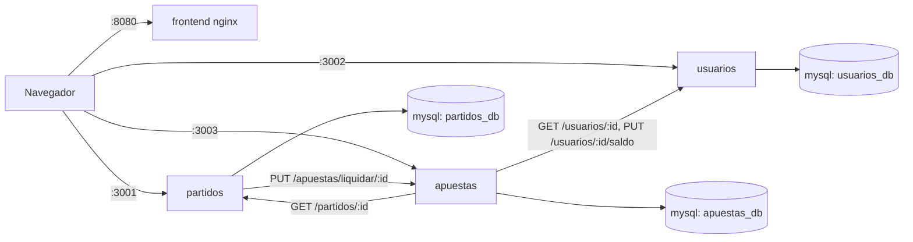

# Despliegue en Docker del proyecto Hitblack (casino de apuestas con microservicios)

Aplicación Node.js desarrollada en el módulo 1 (microservicios), desplegada con Docker, Docker Compose y Docker Swarm, y evaluada con JMeter.

## 1. Componentes y arquitectura

| Componente | Tecnología | Puerto | Base de datos | Responsabilidad |
|---|---|---|---|---|
| `frontend` | HTML + JS estático servido por nginx | 8080 (→ 80) | — | Interfaz web: login, registro, partidos, apuestas, administración |
| `usuarios` | Node.js 20 + Express 5 + bcrypt | 3002 | `usuarios_db` | Registro, login, CRUD de usuarios y saldo |
| `partidos` | Node.js 20 + Express 5 | 3001 | `partidos_db` | CRUD de partidos, cuotas y finalización de partidos |
| `apuestas` | Node.js 20 + Express 5 | 3003 | `apuestas_db` | Crear apuestas y liquidarlas |
| `mysql` | MySQL 8.0 | 3306 (solo red interna) | las tres bases | Persistencia (una base por microservicio) |

Cada microservicio sigue la misma estructura en capas: `routes` → `controllers` → `models` → `config/db.js` (pool `mysql2`).

### Relaciones entre microservicios



- **apuestas → partidos:** verifica que el partido exista y esté `PENDIENTE`, y obtiene la cuota.
- **apuestas → usuarios:** verifica el saldo y lo descuenta (`PUT /usuarios/:id/saldo`).
- **partidos → apuestas:** al finalizar un partido, llama a `/apuestas/liquidar/:id`, que marca las apuestas como ganadas o perdidas y abona la ganancia en `usuarios`.
- Las llamadas entre servicios usan **el nombre del servicio** definido en `docker-compose.yml` (`http://partidos:3001`, `http://usuarios:3002`, `http://apuestas:3003`) mediante las variables `PARTIDOS_SERVICE_URL`, `USUARIOS_SERVICE_URL` y `APUESTAS_SERVICE_URL`. El nombre de host de la base de datos es `mysql` (`DB_HOST`).
- El navegador llama directamente a los tres puertos publicados; `frontend/js/config.js` usa el mismo host desde el que se cargó la página.

## 2. Despliegue

Requisitos: Docker Engine 24+ y el plugin Compose, en el servidor (Ubuntu 2).

```bash
git clone https://github.com/nicocho2007-rgb/Proyecto--apuestas.git
cd Proyecto--apuestas
cp .env.example .env        # contraseña de MySQL (opcional, hay un valor por defecto)
```

### 2.1 Docker (sin Compose) — referencia de lo que automatiza Compose

```bash
docker network create hitblack
docker build -t hitblack/usuarios ./usuarios
docker build -t hitblack/partidos ./partidos
docker build -t hitblack/apuestas ./apuestas
docker build -t hitblack/frontend ./frontend

docker run -d --name mysql --network hitblack -e MYSQL_ROOT_PASSWORD=hitblack_root_2026 \
  -v mysql_data:/var/lib/mysql \
  -v $PWD/usuarios/schema.sql:/docker-entrypoint-initdb.d/01-usuarios.sql:ro \
  -v $PWD/partidos/schema.sql:/docker-entrypoint-initdb.d/02-partidos.sql:ro \
  -v $PWD/apuestas/schema.sql:/docker-entrypoint-initdb.d/03-apuestas.sql:ro \
  -v $PWD/db-init/04-seed.sql:/docker-entrypoint-initdb.d/04-seed.sql:ro \
  mysql:8.0 --max_connections=500
# esperar ~30 s a que MySQL inicialice
docker run -d --name usuarios --network hitblack -p 3002:3002 -e PORT=3002 \
  -e DB_HOST=mysql -e DB_USER=root -e DB_PASSWORD=hitblack_root_2026 -e DB_NAME=usuarios_db hitblack/usuarios
docker run -d --name partidos --network hitblack -p 3001:3001 -e PORT=3001 \
  -e DB_HOST=mysql -e DB_USER=root -e DB_PASSWORD=hitblack_root_2026 -e DB_NAME=partidos_db \
  -e APUESTAS_SERVICE_URL=http://apuestas:3003 hitblack/partidos
docker run -d --name apuestas --network hitblack -p 3003:3003 -e PORT=3003 \
  -e DB_HOST=mysql -e DB_USER=root -e DB_PASSWORD=hitblack_root_2026 -e DB_NAME=apuestas_db \
  -e PARTIDOS_SERVICE_URL=http://partidos:3001 -e USUARIOS_SERVICE_URL=http://usuarios:3002 hitblack/apuestas
docker run -d --name frontend --network hitblack -p 8080:80 hitblack/frontend
```

Limpiar antes de pasar al siguiente método: `docker rm -f frontend apuestas partidos usuarios mysql && docker network rm hitblack`.

### 2.2 Docker Compose

```bash
docker compose up -d --build
docker compose ps
```

- Web: `http://IP_DEL_SERVIDOR:8080`
- Comprobar API: `curl http://localhost:3001/partidos` (debe devolver los 3 partidos de prueba).
- Logs: `docker compose logs -f apuestas`
- Bajar: `docker compose down` (con `-v` borra también los datos).

### 2.3 Docker Swarm

```bash
docker compose down                       # liberar los puertos
docker compose build                      # construye las imágenes hitblack/*
docker swarm init                         # una sola vez (--advertise-addr IP si hay varias interfaces)
docker stack deploy -c docker-stack.yml hitblack
docker stack services hitblack
```

Escalar un servicio en caliente:

```bash
docker service scale hitblack_apuestas=5 hitblack_partidos=5 hitblack_usuarios=5
# o al desplegar:  REPLICAS=5 docker stack deploy -c docker-stack.yml hitblack
```

El *routing mesh* de Swarm reparte las peticiones a los puertos 3001/3002/3003 entre todas las réplicas, y el DNS interno balancea las llamadas entre servicios (`http://partidos:3001`). Con más de un nodo, las imágenes deben estar en un registro accesible por todos.

Quitar el stack: `docker stack rm hitblack`.

## 3. Pruebas de carga y escalabilidad con JMeter

Plan: `jmeter/hitblack-carga.jmx`. Cada usuario virtual repite en bucle: `GET /partidos`, `POST /usuarios` (registro, con bcrypt: consume CPU), `POST /usuarios/login` y `GET /apuestas`. Todas las peticiones validan que el código HTTP sea 2xx.

Parámetros (`-J`): `host` (por defecto `localhost`), `threads` (50), `ramp` (10 s), `duration` (60 s) y `think` (200 ms).

```bash
jmeter -n -t jmeter/hitblack-carga.jmx -Jhost=IP_DEL_SERVIDOR -Jthreads=50 -Jramp=10 -Jduration=60 \
  -l resultados/1-replica-50.jtl -e -o resultados/1-replica-50-reporte
```

(`-o` exige que la carpeta no exista. Abre `index.html` del reporte para ver throughput, tiempos de respuesta y % de errores.)

### Experimento sugerido

1. **Carga:** con 1 réplica por servicio, ejecutar con 10, 50, 100 y 200 usuarios y anotar los resultados.
2. **Escalabilidad:** repetir los mismos escenarios con 3 y 5 réplicas (`docker service scale ...`) y comparar.
3. Mientras corre la prueba, observar el consumo con `docker stats`.

| Réplicas | Usuarios | Throughput (req/s) | Tiempo medio (ms) | p95 (ms) | % errores |
|---|---|---|---|---|---|
| 1 | 10 | | | | |
| 1 | 50 | | | | |
| 1 | 100 | | | | |
| 1 | 200 | | | | |
| 3 | 100 | | | | |
| 3 | 200 | | | | |
| 5 | 200 | | | | |

**Cómo interpretar:** si al subir las réplicas el throughput aumenta y los tiempos bajan, el cuello de botella eran los servicios Node (sobre todo bcrypt en `usuarios`). Si deja de mejorar, el límite pasa a ser MySQL (una sola instancia) o la CPU de la máquina donde corren las pruebas.

## 4. Notas

- Los scripts SQL solo se ejecutan la primera vez que se crea el volumen de MySQL. Para reiniciar los datos: `docker compose down -v`.
- Los datos de `04-seed.sql` (3 partidos) existen para que las pruebas y la web tengan contenido.
- La contraseña de MySQL del `.env.example` es de prueba; no uses la misma en producción.
