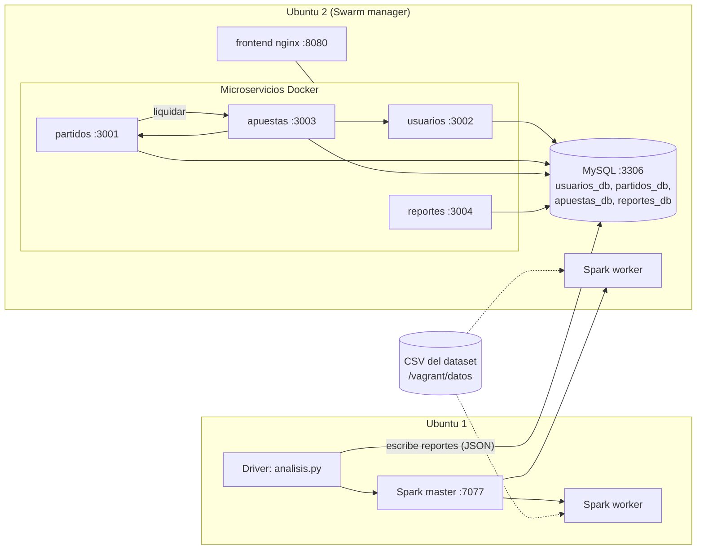

# Hitblack — Proyecto final de Infraestructura

Casino de apuestas deportivas basado en microservicios (Node.js + MySQL), empaquetado en contenedores y desplegado con **Docker, Docker Compose y Docker Swarm**, más un **clúster Apache Spark** que analiza el dataset *European Soccer Database* (Kaggle) y alimenta un **dashboard** dentro de la misma aplicación.

## 1. Arquitectura



| Componente | Tecnología | Puerto | Función |
|---|---|---|---|
| `frontend` | nginx + HTML/JS + Chart.js | 8080 | Interfaz web y `dashboard.html` |
| `usuarios` | Node 20, Express 5, bcrypt | 3002 | Registro, login, saldo |
| `partidos` | Node 20, Express 5 | 3001 | Partidos, cuotas, finalización |
| `apuestas` | Node 20, Express 5 | 3003 | Apuestas y liquidación (llama a usuarios y partidos por nombre de servicio) |
| `reportes` | Node 20, Express 5 | 3004 | Sirve los reportes que genera Spark |
| `mysql` | MySQL 8 | 3306 | Una base por microservicio |
| Spark master/worker | Apache Spark 3.5.3 (Docker, red host) | 7077, UI 8090/8091 | Procesamiento distribuido |

**Flujo de datos:** `database.sqlite` → `exportar_csv.py` → CSV en la carpeta compartida `/vagrant/datos` → job PySpark en el clúster (2 workers, uno por VM) → tabla `reportes` en MySQL → servicio `reportes` → `dashboard.html`.

## 2. Requisitos

- Dos VMs Ubuntu 22.04 (`servidorUbuntu1`, `servidorUbuntu2`) en la red 192.168.100.0/24 (interfaz `eth1`), con la carpeta del `Vagrantfile` compartida en `/vagrant`.
- Docker Engine y plugin Compose en **ambas** VMs (`docker --version`; si falta: `curl -fsSL https://get.docker.com | sudo sh && sudo usermod -aG docker $USER`, y volver a entrar).
- JMeter 5.6+ en el equipo desde el que se lanzan las pruebas.
- El dataset de Kaggle: *European Soccer Database* (Hugo Mathien), archivo `database.sqlite` (~300 MB).

Descomprimir el proyecto en la carpeta compartida (visible desde las dos VMs):

```bash
sudo apt install -y unzip
unzip /vagrant/proyecto-final.zip -d /vagrant/
cd /vagrant/proyecto-final
```

## 3. Parte 1 — Aplicación en contenedores

### 3.1 Docker Compose (una máquina)

```bash
cd /vagrant/proyecto-final
cp .env.example .env
docker compose up -d --build
sleep 60; docker compose ps          # MySQL puede tardar 1-3 min en estar "healthy"
curl localhost:3001/partidos         # 3 partidos de prueba
```

Aplicación en `http://IP_UBUNTU2:8080`. Detener: `docker compose down -v`.

### 3.2 Docker Swarm

```bash
docker compose build
docker swarm init --advertise-addr 192.168.100.3        # IP de eth1 de Ubuntu 2
docker stack deploy -c docker-stack.yml hitblack
docker stack services hitblack                          # 3/3 réplicas por microservicio
```

Escalar: `docker service scale --detach hitblack_apuestas=5` (siempre con `--detach`).
Quitar: `docker stack rm hitblack`.

### 3.3 Swarm en 2 nodos (balanceo entre máquinas)

En Ubuntu 2 (manager), empaquetar las imágenes y obtener el comando de unión:

```bash
docker save hitblack/usuarios hitblack/partidos hitblack/apuestas hitblack/reportes hitblack/frontend -o /vagrant/imagenes.tar
docker swarm join-token worker
```

En Ubuntu 1:

```bash
docker load -i /vagrant/imagenes.tar
docker swarm join --token <TOKEN> --advertise-addr <IP_ETH1_UBUNTU1> 192.168.100.3:2377
```

De vuelta en Ubuntu 2: `docker node ls` (2 nodos `Ready`) y `docker stack deploy -c docker-stack.yml hitblack`; con `docker service ps hitblack_apuestas` se ve cómo las réplicas quedan repartidas en los dos nodos.

## 4. Parte 2 — Clúster Spark y análisis

### 4.1 Preparar los datos (una vez, en Ubuntu 2)

```bash
mkdir -p ~/datos && unzip /vagrant/dataset.zip -d ~/datos        # database.sqlite
python3 /vagrant/proyecto-final/spark/exportar_csv.py ~/datos/database.sqlite /vagrant/datos
```

Genera `match.csv`, `league.csv`, `team.csv`, `player.csv` y `player_attributes.csv` en `/vagrant/datos`, visibles desde las dos VMs.

### 4.2 Levantar el clúster

Ubuntu 1 (master + worker). Anotar la IP que imprime:

```bash
cd /vagrant/proyecto-final/spark
bash 01_master.sh            # opcional: bash 01_master.sh 1g 1   (memoria y núcleos del worker)
```

Ubuntu 2 (segundo worker):

```bash
cd /vagrant/proyecto-final/spark
bash 02_worker.sh IP_DE_UBUNTU1
```

Verificar en `http://IP_UBUNTU1:8090`: deben aparecer 2 workers `ALIVE`.

### 4.3 Ejecutar el análisis (en Ubuntu 1)

La aplicación debe estar desplegada (MySQL publicado en el puerto 3306 de Ubuntu 2):

```bash
cd /vagrant/proyecto-final/spark
MYSQL_HOST=192.168.100.3 bash 03_ejecutar_job.sh
```

Al terminar imprime `TIEMPO_TOTAL_S=...` y `10 reportes guardados en MySQL`. Abrir `http://IP_UBUNTU2:8080/dashboard.html`.

El job calcula: resultados por liga, acierto del favorito, calibración de las cuotas, margen por casa, equipos que sorprenden, ROI de estrategias (siempre local/empate/visitante/favorito), goles por temporada y top de jugadores.

## 5. Pruebas

**Funcionales**
```bash
curl localhost:3001/partidos              # partidos
curl localhost:3004/reportes              # lista de reportes (tras el job)
curl localhost:3004/reportes/roi_estrategias
```
Más el flujo web: registrarse → iniciar sesión → apostar → (admin) finalizar partido → ver saldo.

**Balanceo de carga** (Swarm con varias réplicas): cada respuesta muestra una instancia distinta.
```bash
for i in $(seq 1 10); do curl -s localhost:3004/reportes/salud; echo; done
```

**Carga y escalabilidad de la aplicación (JMeter)** — plan `jmeter/hitblack-carga.jmx` (partidos, registro, login, apuestas, reportes). JMeter no hace falta instalarlo: se ejecuta en un contenedor desde Ubuntu 1 contra el manager (Ubuntu 2). Ajusta la IP si cambia:
```bash
cd /vagrant/proyecto-final/jmeter
docker run --rm --network host -v "$PWD":/work justb4/jmeter:5.5 \
  -n -t /work/hitblack-carga.jmx -Jhost=192.168.100.3 -Jthreads=100 -Jramp=10 -Jduration=60 -l /work/r1.jtl
```
Repetir con 1 y 2 réplicas (`REPLICAS=1` / `REPLICAS=2 docker stack deploy -c docker-stack.yml hitblack`, o `docker service update --force --detach hitblack_<servicio>`) y comparar throughput, tiempo medio, p95 y % de errores. Con ~3 GB por VM conviene detener el clúster Spark durante estas pruebas.

**Escalabilidad de Spark** — mismo job, volumen replicado con `--escala` (solo para medir; no guarda en MySQL). Reducir Swarm a 1 réplica para liberar memoria.
```bash
# 1 worker (en Ubuntu 2: docker compose stop worker)
TOTAL_CORES=1 bash 03_ejecutar_job.sh --escala 100 --no-guardar
# 2 workers (en Ubuntu 2: docker compose start worker)
TOTAL_CORES=2 bash 03_ejecutar_job.sh --escala 100 --no-guardar
```
Anotar `TIEMPO_TOTAL_S` de cada corrida (repetir 3 veces y promediar) y calcular el *speedup* = tiempo(1 worker) / tiempo(2 workers). Ajustar `--escala` para que la corrida de 1 worker tarde ~1-2 minutos.


### Resultados medidos

Entorno: 2 VM Ubuntu 22.04 (~3 GB RAM), red host-only 192.168.100.0/24, Swarm de 2 nodos, JMeter con 100 hilos y 60 s.

| Métrica | 1 réplica | 2 réplicas | Mejora |
|---|---|---|---|
| Throughput (req/s) | 41,8 | 76,3 | 1,8× |
| Registro, media (s) | 6,54 | 3,40 | −48 % |
| Login, media (s) | 2,43 | 1,31 | −46 % |
| Percentil 95 (s) | 7,85 | 3,94 | −50 % |
| Errores | 0 | 0 | — |

Spark, mismo job con 1 y 2 núcleos (tiempo total en s):

| Escala (partidos) | 1 núcleo | 2 núcleos | Speedup |
|---|---|---|---|
| ×8 (208 mil) | 52,6 | 66,5 | 0,79× |
| ×30 (779 mil) | 78,8 | 79,0 | 1,00× |
| ×150 (3,9 M) | 208,7 | 138,5 | 1,51× |

Datos crudos en `docs/resultados_spark.txt` y `jmeter/r1.jtl`, `jmeter/r2.jtl`. El análisis completo está en `docs/Informe_IEEE_hitblack.docx` y las diapositivas en `docs/Presentacion_hitblack.pptx`.

## 6. Estructura del repositorio

```
usuarios/ partidos/ apuestas/ reportes/   microservicios (cada uno con Dockerfile y schema.sql)
frontend/                                 HTML/JS, dashboard.html, Chart.js local
db-init/                                  datos de prueba de partidos
docker-compose.yml  docker-stack.yml      despliegue en Compose y Swarm
spark/                                    Dockerfile, compose del clúster, scripts 01-03, analisis.py, exportar_csv.py
jmeter/hitblack-carga.jmx                 plan de pruebas de carga (y r1.jtl / r2.jtl con los resultados)
docs/                                     informe IEEE, diapositivas y resultados de Spark
vagrant/Vagrantfile                       las 2 VM Ubuntu (192.168.100.2 y .3)
```

## 7. Problemas frecuentes

| Síntoma | Causa / solución |
|---|---|
| `dependency mysql failed to start` | MySQL tarda en la primera inicialización; esperar y repetir `docker compose up -d` |
| `network hitblack_hitblack already exists` al desplegar en Swarm | Falta `docker compose down -v` antes del `stack deploy` |
| `could not choose an IP address to advertise` | Usar `--advertise-addr` con la IP de eth1 (192.168.100.x) |
| Workers de Spark no aparecen en el master | Revisar la IP en `spark/.env` y que no se use la IP NAT 10.0.2.15 |
| El job no conecta a MySQL | Usar `MYSQL_HOST=192.168.100.3` y comprobar que el stack publica el puerto 3306 |
| `docker service scale` queda esperando | Usar siempre `--detach` |
| Dashboard dice "Todavía no hay reportes" | Ejecutar `03_ejecutar_job.sh` y recargar |
